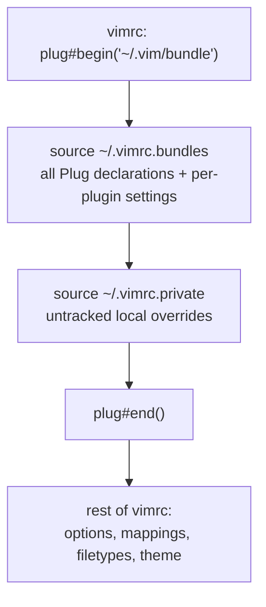

# CLAUDE.md

This file provides guidance to Claude Code (claude.ai/code) when working with code in this repository.

## What this repository is

`vim-config` ([D0n9X1n/vim-config](https://github.com/D0n9X1n/vim-config)) is a personal Vim configuration. There is no build, no package manager, and no test suite. The repository **is** the live Vim runtime directory: `install.sh` symlinks the checkout itself to `~/.vim`, so an edit to a tracked file changes the running editor on the next Vim start. Nothing needs to be "deployed".

```
~/.vim            -> <repo root>
~/.vimrc          -> <repo>/vimrc
~/.vimrc.bundles  -> <repo>/vimrc.bundles
~/.vimrc.private  -> <repo>/vimrc.private   (untracked)
```

`install.sh` date-stamps and moves aside real files, unlinks existing symlinks, then recreates the links. Re-running it is safe. Its backup and unlink loops cover five paths — the four above plus `~/.gvimrc`, which is cleared but never re-linked — so a pre-existing real file at any of them is preserved as `<path>.<YYYYMMDD>` before being replaced.

## Load order

The non-obvious part: `vimrc` opens the plugin block, then sources the *other two* files from inside it. Every `Plug` declaration lives in `vimrc.bundles`, not `vimrc`.



Consequences for editing:

- A new plugin **and its configuration** go in `vimrc.bundles`, grouped under the existing banner comments.
- Editor options, key mappings, filetype rules, and the colorscheme go in `vimrc`.
- `plug#end()` runs `filetype plugin indent on` and `syntax enable`, so anything overriding plugin defaults belongs after it. Highlight overrides specifically go in `s:ApplyHighlightOverrides()` near the end of `vimrc` — see [Theme](#theme) for why they cannot be inline.

## Tracked vs. generated

Only the configuration files are tracked — about twenty. `bundle/` holds 50 plugin checkouts and is gitignored despite sitting right there on disk: it is generated by vim-plug and never committed. `vimrc.private` is ignored too, so local overrides stay out of the repository.

`.gitignore` is a 4000-line concatenation of upstream language templates, and the rules that actually matter for this repo are scattered inside it (`bundle/` is at line 4060). Grep it rather than reading it, and prefer `git check-ignore -v <path>` to decide whether something is ignored. Note that `view/` appears in `.gitignore` but already has a tracked file committed under it — tracked files win over ignore rules.

`autoload/plug.vim` is an exception: a tracked fork of vim-plug that this repository maintains. `UltiSnips/` holds hand-written snippets and is tracked.

## Plugin management

Run inside Vim: `:PlugInstall`, `:PlugUpdate`, `:PlugClean` (removes checkouts no longer declared), `:PlugStatus`, `:PlugCompact`.

`autoload/plug.vim` is a fork, edited here and never re-downloaded: `:PlugUpgrade` only prints a notice, so upstream fixes have to be ported by hand. The fork is storage-first. Its header comment lists the changes from upstream, and `autoload/plug-compact.sh` does the git work:

- `vimrc` sets `g:plug_shallow = 1`, so clones are depth 1, single-branch, and tagless.
- `:PlugUpdate` fetches only the new tip, then `reset --keep`s to it — never `merge --ff-only`, which fails across depth-1 histories. It then drops old commits, other branches, tags, and reflogs, and runs `gc`, so a plugin holds one commit plus the previous tip that `HEAD@{1}`, `:PlugDiff`, and revert (`X`) read. Submodules get the same treatment.
- `:PlugCompact [names]` shrinks existing checkouts in place without moving them.
- Plugins pinned with `tag` or `commit` keep upstream's deep-history behavior.

Two consequences. A plugin with uncommitted local edits that conflict with an update fails that update (`reset --keep` refuses) instead of losing the edits. And `gc --prune=now` assumes one writer, so do not run `:PlugUpdate` in two Vims at once.

Most of `bundle/` is not git: `YouCompleteMe/third_party/ycmd` holds about 690M of downloaded completers (clangd, libclang, omnisharp, Go), which no plug.vim change reclaims.

Verify plug.vim changes with a headless run against local `file://` bare repos (vim-plug accepts any git URL): install, update, `:PlugDiff`, `:PlugStatus`, `:PlugClean`, asserting on `git rev-list --count --all` and `.git/shallow` in each checkout.

## Two traps when verifying from a shell

**1. `vim` is aliased to `nvim` on this machine.** Neovim reads neither `~/.vimrc` nor `~/.vim`, so an aliased invocation silently exercises a completely different configuration and fails with `E117: Unknown function: plug#begin`. Always use the absolute path:

```sh
/opt/homebrew/bin/vim --version | head -1    # VIM 9.2, +termguicolors
```

**2. The `colorscheme` call in `vimrc` is unguarded.** If the theme is not yet in `bundle/`, startup raises `E185` and blocks on *Press ENTER*, so `vim -u ~/.vimrc -c 'PlugInstall'` cannot bootstrap a fresh machine — Vim exits before the command runs. Bootstrap with a minimal init that loads the declarations only:

```vim
" /tmp/bootstrap.vim
set nocompatible
set runtimepath^=~/.vim
call plug#begin('~/.vim/bundle')
source ~/.vimrc.bundles
call plug#end()
```

```sh
/opt/homebrew/bin/vim -N -u /tmp/bootstrap.vim -c 'PlugInstall --sync' -c 'qa!' < /dev/null
```

## Verifying a configuration change

There are no tests. Verify by loading the real `vimrc` headlessly and asserting on resolved state — redirect stdin from `/dev/null` so an error prompt cannot hang the run, and write results to a file rather than relying on `:echo`, which is swallowed in silent mode:

```sh
/opt/homebrew/bin/vim -N -u ~/.vimrc \
  -c 'call writefile(["colors_name=".get(g:,"colors_name","<unset>"),
      "termguicolors=".&termguicolors,
      "Normal_guibg=".synIDattr(synIDtrans(hlID("Normal")),"bg#","gui")],
      "/tmp/verify.txt")' \
  -c 'qa!' < /dev/null 2>&1 | cat -v | grep -oE 'E[0-9]+: [^^]*'
cat /tmp/verify.txt
```

An empty grep result means no startup errors.

## Theme

The active colorscheme is [Apollo](https://github.com/apollo-theme/vim-apollo-theme) — truecolor with xterm-256 fallbacks, in two variants: `apollo` (dark) and `apollo-light`, added upstream in v0.2.0. Other colorschemes stay installed as alternatives, so switching is a one-line edit in the theme section of `vimrc`.

Each variant asserts its own `set background=` line at the top of its colors file (`apollo.vim` sets `dark`, `apollo-light.vim` sets `light`), so `SetBGColor()` (`<leader>b`) names the colorscheme and nothing else. Setting the option alongside it is redundant on success and harmful on failure: `bundle/` is gitignored and unpinned, so a checkout predating a variant is possible, and on `E185` the option would flip while the old colors stayed — leaving `&background` disagreeing with the screen and `g:colors_name` unset, which silently disables colorscheme reloading for the rest of the session. Naming only the scheme makes a failed switch a no-op. Any future light/dark pairing has to do the same.

Highlight tweaks layered on top of the colorscheme live in `s:ApplyHighlightOverrides()` and re-apply from an `autocmd ColorScheme`. They have to: every colorscheme load issues `highlight clear`, so inline `hi!` statements survive only until the next `:colorscheme` — which `<leader>b` triggers. Add new overrides inside that function, not after the `colorscheme` call.

Apollo ships its own checks, runnable from its checkout:

```sh
cd ~/.vim/bundle/vim-apollo-theme
/opt/homebrew/bin/vim -Nu NONE -n -es -i NONE -S tests/headless.vim
```
