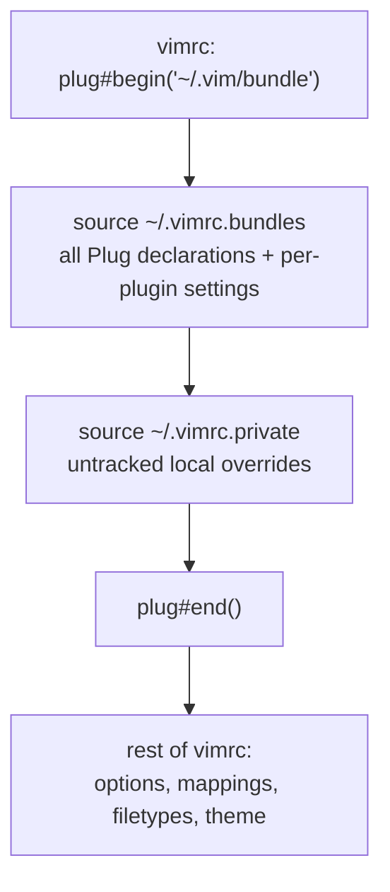

# CLAUDE.md

This file provides guidance to Claude Code (claude.ai/code) when working with code in this repository.

## What this repository is

A personal Vim configuration. There is no build, no package manager, and no test suite. The repository **is** the live Vim runtime directory: `install.sh` symlinks the checkout itself to `~/.vim`, so an edit to a tracked file changes the running editor on the next Vim start. Nothing needs to be "deployed".

```
~/.vim            -> <repo root>
~/.vimrc          -> <repo>/vimrc
~/.vimrc.bundles  -> <repo>/vimrc.bundles
~/.vimrc.private  -> <repo>/vimrc.private   (untracked)
```

`install.sh` date-stamps and moves aside real files, unlinks existing symlinks, then recreates all four links. Re-running it on an already-installed machine is safe.

**It is not safe on a machine that has a real `~/.vimrc.private`.** The backup and unlink loops (`install.sh:17-18`) cover `~/.vim`, `~/.vimrc`, `~/.gvimrc`, and `~/.vimrc.bundles` — but not `~/.vimrc.private`, which line 25 then symlinks over with `ln -sf`. A pre-existing file there is destroyed with no dated backup. Verified against a sandboxed `HOME`: a real `~/.vimrc.private` was replaced by the symlink, and no `.vimrc.private.<date>` was written. Adding `$HOME/.vimrc.private` to both loops fixes it.

## Load order

The non-obvious part: `vimrc` opens the plugin block, then sources the *other two* files from inside it. Every `Plug` declaration lives in `vimrc.bundles`, not `vimrc`.



Consequences for editing:

- A new plugin **and its configuration** go in `vimrc.bundles`, grouped under the existing banner comments.
- Editor options, key mappings, filetype rules, and the colorscheme go in `vimrc`.
- `plug#end()` runs `filetype plugin indent on` and `syntax enable`, so anything that must override plugin defaults — the `hi! link` and `highlight Spell*` statements at the end of `vimrc` — has to stay after the `colorscheme` call.

## Tracked vs. generated

Only the configuration files are tracked — about twenty. `bundle/` holds 50 plugin checkouts and is gitignored despite sitting right there on disk: it is generated by vim-plug and never committed. `vimrc.private` is ignored too, so local overrides stay out of the repository.

`.gitignore` is a 4000-line concatenation of upstream language templates, and the rules that actually matter for this repo are scattered inside it (`bundle/` is at line 4060). Grep it rather than reading it, and prefer `git check-ignore -v <path>` to decide whether something is ignored. Note that `view/` appears in `.gitignore` but already has a tracked file committed under it — tracked files win over ignore rules.

`autoload/plug.vim` is an exception: a vendored, tracked copy of vim-plug, updated with `:PlugUpgrade`. `UltiSnips/` holds hand-written snippets and is tracked.

## Plugin management

Run inside Vim: `:PlugInstall`, `:PlugUpdate`, `:PlugClean` (removes checkouts no longer declared), `:PlugStatus`, `:PlugUpgrade`.

## Two traps when verifying from a shell

**1. `vim` is aliased to `nvim` on this machine.** Neovim reads neither `~/.vimrc` nor `~/.vim`, so an aliased invocation silently exercises a completely different configuration and fails with `E117: Unknown function: plug#begin`. Always use the absolute path:

```sh
/opt/homebrew/bin/vim --version | head -1    # VIM 9.2, +termguicolors
```

**2. The `colorscheme` call in `vimrc` is unguarded.** If the theme is not yet in `bundle/`, startup raises `E185` and blocks on *Press ENTER*, so `vim -u ~/.vimrc -c 'PlugInstall'` cannot bootstrap a fresh machine — Vim exits before the command runs. Bootstrap with a minimal init that loads the declarations only:

```vim
" /tmp/bootstrap.vim
set nocompatible
set runtimepath^=~/.vim
call plug#begin('~/.vim/bundle')
source ~/.vimrc.bundles
call plug#end()
```

```sh
/opt/homebrew/bin/vim -N -u /tmp/bootstrap.vim -c 'PlugInstall --sync' -c 'qa!' < /dev/null
```

## Verifying a configuration change

There are no tests. Verify by loading the real `vimrc` headlessly and asserting on resolved state — redirect stdin from `/dev/null` so an error prompt cannot hang the run, and write results to a file rather than relying on `:echo`, which is swallowed in silent mode:

```sh
/opt/homebrew/bin/vim -N -u ~/.vimrc \
  -c 'call writefile(["colors_name=".get(g:,"colors_name","<unset>"),
      "termguicolors=".&termguicolors,
      "Normal_guibg=".synIDattr(synIDtrans(hlID("Normal")),"bg#","gui")],
      "/tmp/verify.txt")' \
  -c 'qa!' < /dev/null 2>&1 | cat -v | grep -oE 'E[0-9]+: [^^]*'
cat /tmp/verify.txt
```

An empty grep result means no startup errors.

## Theme

The active colorscheme is [Apollo](https://github.com/apollo-theme/vim-apollo-theme) — dark, truecolor with xterm-256 fallbacks. Other colorschemes stay installed as alternatives, so switching is a one-line edit in the theme section of `vimrc`.

Apollo is dark-only and asserts `set background=dark` at the top of its `colors/apollo.vim`. Vim re-sources the active colorscheme whenever `background` changes, so flipping that option alone gets immediately undone by Apollo — leaving `&background` reading `light` while the canvas stays dark, and `g:colors_name` unset, which silently disables colorscheme reloading for the rest of the session. `SetBGColor()` (`<leader>b`) therefore names a colorscheme on *both* branches — gruvbox for light, Apollo for dark. Any future light/dark pairing has to do the same.

Known quirk, pre-dating the Apollo switch: the `hi! link` and `highlight Spell*` overrides at the end of `vimrc` run once at startup, and every colorscheme reload issues `highlight clear`, which drops them. So `<leader>b` loses the sign-column link and the softened spell highlights until Vim restarts. Fixing it means re-applying them from an `autocmd ColorScheme` rather than inline.

Apollo ships its own checks, runnable from its checkout:

```sh
cd ~/.vim/bundle/vim-apollo-theme
/opt/homebrew/bin/vim -Nu NONE -n -es -i NONE -S tests/headless.vim
```
